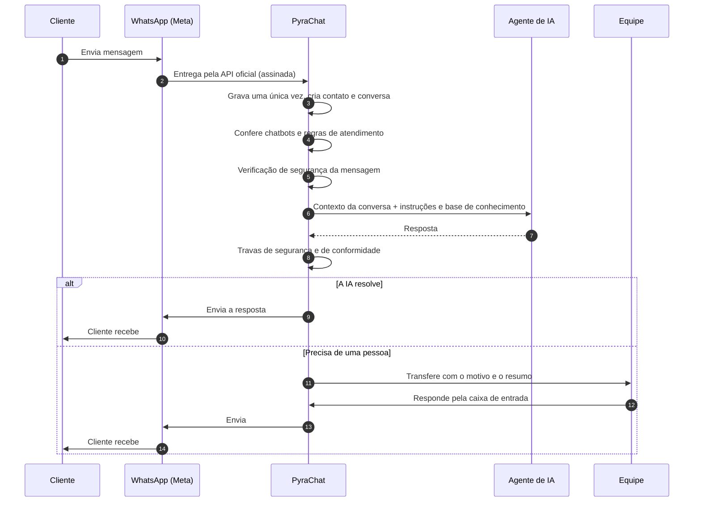

<picture>
  <source media="(prefers-color-scheme: dark)" srcset="https://pyrachat.com/marca/pyrachat-logo.svg" />
  
</picture>

### A IA atende. Sua equipe fecha.

Atendimento pelo WhatsApp com agentes de IA e equipe na mesma caixa de entrada.

**[pyrachat.com](https://pyrachat.com)** · [Entrar na plataforma](https://app.pyrachat.com) · [contato@pyrachat.com](mailto:contato@pyrachat.com)

> [!NOTE]
> **Este repositório é só documentação.** Ele explica o que é a PyraChat, como ela funciona e o que vem por aí. Não há código-fonte aqui: o código da PyraChat é proprietário e não é público.

## Sumário

- [O que é a PyraChat](#o-que-é-a-pyrachat)
- [Para quem é](#para-quem-é)
- [Como funciona: a orquestração](#como-funciona-a-orquestração)
- [O que a plataforma faz hoje](#o-que-a-plataforma-faz-hoje)
- [A IA da PyraChat](#a-ia-da-pyrachat)
- [Planos](#planos)
- [Segurança e privacidade](#segurança-e-privacidade)
- [Próximas atualizações](#próximas-atualizações)
- [Linha do tempo](#linha-do-tempo)
- [Contato](#contato)

## O que é a PyraChat

A PyraChat é uma plataforma de atendimento pelo **WhatsApp oficial**. Agentes de inteligência artificial respondem os clientes a qualquer hora, seguindo as instruções da sua empresa, e passam a conversa para uma pessoa da equipe quando é a hora certa, com o resumo pronto.

Tudo acontece num lugar só: a caixa de entrada da equipe, o CRM com os contatos e o funil de vendas, as campanhas, os chatbots, a agenda e os relatórios. A entrada de toda a equipe é pela **Conta Pyra**, em `account.pyrachat.com`.

Mais sobre cada parte: [CRM no WhatsApp](https://pyrachat.com/crm-whatsapp) e [Agente de IA](https://pyrachat.com/agente-ia).

## Para quem é

**O céu é o limite.** A PyraChat atende qualquer negócio que conversa com clientes pelo WhatsApp, de qualquer porte e segmento: do profissional que trabalha sozinho à grande operação com várias equipes.

| Atendimento presencial | Vendas e serviços pela internet |
|---|---|
| Clínicas, consultórios e estética | Lojas online e e-commerce |
| Imobiliárias e corretores | Cursos, mentorias e infoprodutos |
| Restaurantes, bares e delivery | Agências e prestadores de serviço |
| Academias, salões e studios | SaaS e empresas B2B |
| Escritórios, oficinas e lojas físicas | Qualquer operação com muitas conversas |

Empresas contratam com CNPJ. Pessoas físicas, a partir de 18 anos, também podem contratar; quem vende sem CNPJ já pode fazer a [pré-inscrição](https://pyrachat.com/pre-inscricao) como pessoa física.

## Como funciona: a orquestração

Cada mensagem passa por uma sequência de etapas pensada para responder rápido, sem perder nada e sem expor o número da empresa a bloqueios.

1. **Entrada segura.** O WhatsApp entrega a mensagem pela API oficial da Meta. A PyraChat confere a assinatura de cada entrega e grava cada mensagem uma única vez, mesmo que a Meta reenvie. No lançamento, o número também poderá ser conectado por QR Code, uma conexão mais rápida que não usa a API oficial (com o aviso de risco antes).
2. **Fila e ordem.** As mensagens entram numa fila e são processadas em segundo plano, na ordem certa. Se algo cair no meio, nada se perde e nada é enviado em dobro.
3. **Chatbots e regras.** Antes da IA, valem as regras da empresa: horário de atendimento, boas-vindas, palavras-chave e chatbots (por exemplo, oferecer horários da agenda).
4. **Verificação de segurança.** Cada mensagem do cliente passa por uma verificação automática, feita em São Paulo. Tentativa de manipular a IA, pedido que só a equipe pode autorizar ou menção a uma emergência vão direto para a equipe, sem resposta automática.
5. **Agente de IA.** A IA espera alguns segundos para juntar mensagens seguidas e responde com o contexto **só daquela conversa**, a base de conhecimento e as instruções que a empresa definiu: tom, regras, limites e quando chamar uma pessoa.
6. **Travas antes de responder.** A resposta passa por conferências contra vazamento de instruções, links fora do combinado e repetição. Tudo é verificado de novo logo antes do envio; se o cliente mandou algo novo nesse meio tempo, a resposta antiga é descartada.
7. **Transferência para a equipe.** Quando o cliente pede uma pessoa, quando a IA não deve responder ou quando algum limite é atingido, a conversa vai para a equipe com o motivo e o resumo, distribuída por rodízio.
8. **Envio com conformidade.** Toda mensagem, da IA ou da equipe, passa pela trava de envio: janela de 24 horas, consentimento do cliente, qualidade do número e limites da Meta.
9. **Tempo real.** A equipe vê tudo acontecer ao vivo na caixa de entrada, no computador ou no celular.
10. **Depois da conversa.** O contato fica no cadastro com etiquetas e campos, a oportunidade anda no funil, o agendamento entra na agenda (dá para marcar sem sair da conversa) e tudo vira relatório.

## O que a plataforma faz hoje

| Módulo | O que você consegue fazer |
|---|---|
| **Início e primeiros passos** | Resumo da operação e os passos para começar, em ordem: conectar o número, criar e testar o agente e ativar a IA. Cada passo pode ser pulado e retomado depois. |
| **Conversas** | Caixa de entrada em tempo real, setores com rodízio, assumir e transferir, notas internas, respostas rápidas, horário de atendimento e mensagens automáticas. Agendamentos e oportunidades do cliente ao lado da conversa. |
| **Agentes de IA** | Criar agentes por etapas (papel, objetivo, regras, exemplos), com base de conhecimento, teste antes de publicar, versões e a escolha entre responder sozinho ou só sugerir respostas. |
| **WhatsApp** | Conexão oficial pela Meta em etapas, com a opção de continuar usando o WhatsApp Business no celular e trazer as conversas dos últimos 6 meses. Templates, qualidade de cada número dada pela Meta (com aviso quando cai) e o motivo completo quando a Meta recusa algo. No lançamento, conexão por QR Code, com recusa automática de ligações e ritmo de envio que protege o número. |
| **Contatos** | Etiquetas, campos personalizados, segmentos e importação de planilhas. Exportar ou apagar os dados de um contato a pedido dele. |
| **Funil** | Etapas de venda, oportunidades com valor e um quadro para arrastar. |
| **Campanhas** | Envios para segmentos ou etiquetas, com agendamento, ritmo controlado e relatório de entregues e lidos. |
| **Chatbots** | Editor visual de automações: gatilhos (palavra-chave, contato novo, etiqueta, etapa do funil, conversa encerrada, lembrete e falta na agenda) e blocos (mensagem, botões, listas, mídia, esperar, condições, IA, divisão de público, oferecer horários). Prévia num WhatsApp simulado. |
| **Agenda** | Calendários com capacidade, visão de dia, semana e mês, horários oferecidos pelo próprio chatbot, lembrete e aviso de falta. |
| **Relatórios** | Atendimento, IA, equipe e agenda: primeira resposta, tempo de resolução, carga por pessoa, consumo de IA e comparecimento. |
| **API e integrações** | API pública em `api.pyrachat.com/v1` para conectar sistemas próprios: contatos com consentimento registrado, mensagens (texto, template e arquivo), mensagens agendadas para até 12 meses, conversas, etiquetas, resumo dos relatórios e avisos assinados no sistema do cliente, escolhendo de quais números. Chaves com permissões escolhidas (uma chave nova começa só com leitura), códigos de falha estáveis e documentação completa em [docs.pyrachat.com](https://docs.pyrachat.com). |
| **Central de Ajuda** | Mais de 130 artigos com a imagem de cada tela e o passo a passo numerado, perguntas frequentes e atendimento por chat em [ajuda.pyrachat.com](https://ajuda.pyrachat.com). |
| **Conta Pyra e equipe** | Uma entrada só para a equipe, com senha, verificação em duas etapas e sessões na Conta Pyra. Papéis (dono, administrador, atendente, leitura), convites por e-mail, duas etapas obrigatórias para toda a empresa se o dono quiser, logo da empresa no menu, registro de auditoria e exportação de todos os dados da empresa num arquivo só. |
| **Visual** | Tema escuro (padrão), claro ou igual ao do aparelho, busca de telas com Ctrl K (⌘ K no Mac) e menu em gaveta no celular. |

## A IA da PyraChat

A IA da PyraChat roda no **Amazon Bedrock**, serviço da Amazon, e tem três níveis, para equilibrar custo e capacidade em cada agente:

| Nível | Modelo | Preço de tabela (a cada 10 mil tokens) |
|---|---|---|
| **Pyra Lite** | Claude Haiku 4.5 (Anthropic) | R$ 0,0545 |
| **Pyra Max** | Claude Sonnet 4.6 (Anthropic) | R$ 0,1245 |
| **Pyra Ultra** | Kimi K3.1 (Moonshot AI) | R$ 0,1845 |

- **Cobrança por token, não por mensagem.** Você paga pelo que a IA lê e escreve (entrada e saída somadas), com o desconto do seu plano em cada nível.
- **Feita para atendimento.** A IA já vem ligada à caixa de entrada, à transferência para a equipe, ao funil e à agenda, com travas pensadas para conversas com clientes.
- **Verificação de segurança antes de a IA agir**, feita em São Paulo, em toda mensagem do cliente.
- **Base de conhecimento.** O conteúdo que a empresa ensina vira vetores no Amazon Bedrock, para a IA achar o trecho certo de cada resposta.
- **Caminho dos dados.** Os pedidos saem de São Paulo e podem ser processados em servidores da Amazon em outros países. As empresas que criaram os modelos não recebem as conversas, e as conversas não são usadas para treinar modelos sem autorização expressa.

## Planos

| Plano | Sem crédito de IA | Com crédito de IA | Crédito de IA por mês |
|---|---|---|---|
| **Pyra Start** | R$ 49,90/mês | R$ 79,90/mês | R$ 30 |
| **Pyra Growth** (mais popular) | R$ 119,90/mês | R$ 179,90/mês | R$ 100, com R$ 40 de bônus |
| **Pyra Scale** | R$ 249,90/mês | R$ 349,90/mês | R$ 200, com R$ 100 de bônus |
| **Pyra Enterprise** | sob consulta | sob consulta | negociado; o bônus pode passar de R$ 1.000 |

**Desconto na IA por plano**, sobre o preço de tabela de cada nível:

| Plano | Pyra Lite | Pyra Max | Pyra Ultra |
|---|---|---|---|
| Pyra Start | 10% | preço de tabela | fora do plano |
| Pyra Growth | 15% | 10% | preço de tabela |
| Pyra Scale | 35% | 25% | 20% |
| Pyra Enterprise | 35% | 35% | 35% |

- **Soluções de IA exclusivas:** o Pyra Scale inclui 1 e o Pyra Enterprise, 2, feitas pela equipe da PyraChat para o negócio, com escopo em contrato.
- **Pyra Enterprise:** contrato próprio e contratação mínima trimestral.
- **Crédito de IA com origem e validade:** a Conta Pyra separa o crédito do plano, o bônus e o comprado. O do plano, com o bônus, vale até o fim do mês pago; o comprado vale 12 meses; a IA usa primeiro o que vence antes. Quem é dono de mais de uma empresa pode passar crédito comprado de uma para outra.
- **Crédito avulso (no lançamento):** pacotes de R$ 20 a R$ 500, ou outro valor nessa faixa, por Pix ou cartão.
- **Teste grátis (no lançamento):** até 7 dias para preparar o agente e o número e, depois, 72 horas com a IA atendendo clientes reais. Um teste por empresa ou pessoa.
- **Pagamento (no lançamento):** Pix Automático ou cartão, dentro da própria plataforma, sem link externo. No cartão, a cobrança aparece como **PYRA\* PYRACHAT**. Os dados do cartão ficam com a instituição de pagamento, não com a PyraChat.
- **Dados de cobrança (no lançamento):** com CNPJ, a razão social e o endereço vêm da Receita Federal; com CPF, o CEP completa o endereço.
- **Trocar de plano ou de forma de pagamento (no lançamento)** pela própria plataforma.
- **Cobrança mensal.** Tarifas da Meta pelas mensagens do WhatsApp ficam à parte. As condições em vigor ficam sempre no [Termo de Adesão](https://pyrachat.com/contratacao).

## Segurança e privacidade

- **API oficial do WhatsApp**, da Meta. Nada de conexão não oficial pelo QR code, que coloca o número em risco.
- **Plataforma no Brasil.** A plataforma fica em servidores em São Paulo. Os pedidos à IA saem de São Paulo e podem ser processados pela Amazon em outros países (veja [A IA da PyraChat](#a-ia-da-pyrachat)). A [Política de Privacidade](https://pyrachat.com/privacidade) traz quem processa cada dado e onde ficam as cópias de segurança.
- **Cada empresa isolada.** O isolamento entre empresas é garantido no próprio banco de dados, não só no código, e é testado a cada alteração.
- **Proteção de acesso.** Entrada pela Conta Pyra, verificação em duas etapas (com QR code para o aplicativo autenticador, e obrigatória para toda a empresa se o dono quiser), uma sessão separada para cada endereço, lista de sessões com o aparelho e o último uso, registro de auditoria, pausa depois de tentativas erradas de entrada e verificação contra robôs.
- **Criptografia** dos acessos ao WhatsApp e cópias de segurança cifradas.
- **LGPD.** Termos de Uso, Termo de Adesão, Política de Privacidade e Política de Cookies públicos, com encarregado de dados. As conversas não são usadas para treinar modelos sem autorização expressa.
- **Pedidos de titular.** A empresa exporta ou apaga os dados de um contato, deixa de contatar quem pediu e escolhe por quanto tempo guardar as conversas. O dono exporta todos os dados da empresa quando quiser.
- **Encerramento da conta (no lançamento).** Depois do cancelamento, os dados ficam 30 dias para exportar ou contratar de novo (60 dias na suspensão por falta de pagamento, com aviso antes) e depois são apagados. Fica só o que a lei manda guardar, como os dados de cobrança.
- **E-mails confiáveis.** Confirmação de e-mail, recuperação de senha e convites chegam por e-mail, e endereços que devolvem ou marcam como spam deixam de receber.
- **Falhas de segurança** podem ser comunicadas a [seguranca@pyrachat.com](mailto:seguranca@pyrachat.com).

## Próximas atualizações

O que está planejado ou em estudo. A lista evolui conforme o uso, sem datas fixas, e cada integração depende da aprovação de quem a oferece.

### Pagamentos

- **Pix na conversa:** cobrança gerada pela IA ou pela equipe e baixa automática quando o cliente paga.
- **Gateways de pagamento**, como Mercado Pago, Stripe, Asaas, PagBank, Efí, Pagar.me e Woovi.

### Marketplaces e e-commerce

- **Marketplaces:** perguntas, pedidos e pós-venda de canais como Mercado Livre, Shopee, Amazon e Magalu na mesma caixa de entrada.
- **Plataformas de loja virtual**, como Shopify, Nuvemshop, WooCommerce, VTEX e Tray: status do pedido, carrinho abandonado e recompra.

### Canais

- **Instagram Direct e Messenger**, na mesma caixa de entrada do WhatsApp.

### Gestão e integrações

- **Agenda integrada** ao Google Calendar.
- **Servidor MCP** para conectar assistentes de IA, sobre a API pública.
- **Funil na API:** oportunidades e etapas pela API pública.
- **Pixel da Meta** para medir campanhas.
- **Perfis de permissão** personalizados.

> As marcas citadas pertencem aos seus titulares. A menção indica uma integração prevista ou em estudo, não uma parceria ou endosso.

## Linha do tempo

| Versão | O que chegou |
|---|---|
| v0.55 | Quatro planos (Start, Growth, Scale e Enterprise) com desconto na IA por plano e bônus em crédito, crédito de IA com a origem de cada valor, site novo e as páginas [CRM](https://pyrachat.com/crm-whatsapp) e [Agente de IA](https://pyrachat.com/agente-ia) |
| v0.54 | Conta Pyra: uma entrada só para a equipe, perfil e segurança na conta, e uma sessão separada para cada endereço |
| v0.53 | App com o visual do site, tema igual ao do aparelho, Início, Primeiros passos, Funil e Agenda no menu, agenda e funil dentro da conversa e a qualidade de cada número em Canais |
| v0.52 | Chaves da API com leitura geral e permissão própria para agendar, resumo dos relatórios pela API e as novidades em [pyrachat.com/novidades](https://pyrachat.com/novidades) |
| v0.51 | IA no Amazon Bedrock (Claude e Kimi) com verificação de segurança antes de a IA agir, e o nome PYRA\* PYRACHAT na fatura do cartão |
| v0.50 | E-mails da conta: confirmação, recuperação de senha e convites |
| v0.48 | API com mensagens agendadas, avisos escolhidos por número e códigos de falha estáveis |
| v0.47 | QR Code (no lançamento): recusa automática de ligações, ritmo de envio que protege o número e nenhuma mensagem perdida ou repetida |
| v0.46 | Conexão do WhatsApp por QR Code, passo a passo, com aviso de risco (no lançamento) |
| v0.45 | Conectar o WhatsApp em etapas, continuar usando o WhatsApp Business no celular com o histórico de 6 meses, e o motivo completo dos erros da Meta |
| v0.44 | Pré-inscrição aberta para empresas e pessoas físicas antes do lançamento |
| v0.43 | Central de Ajuda com a imagem de cada tela e o passo a passo numerado |
| v0.42 | Central de Ajuda com mais de 130 artigos, API pública com mensagens, conversas e avisos para o sistema do cliente, e a documentação para desenvolvedores |
| v0.41 | E-mails novos com a identidade da Conta Pyra, nota fiscal automática de cada pagamento com XML e PDF (no lançamento) e termos em nome da Pyra Technologies |
| v0.40 | Chat de atendimento no site, em todas as páginas, com texto, áudio e arquivos, no tema do site |
| v0.39 | Caixa de entrada nova, menu lateral com busca rápida e atalhos de teclado, e Contatos com visões em abas e a ficha ao lado |
| v0.32 | Dados de cobrança pelo CNPJ (Receita Federal) ou pelo CEP, e o teste grátis mostrando o valor e o plano cobrados depois, prontos para o lançamento |
| v0.30 | Exportar todos os dados da empresa num arquivo só, prazos claros no encerramento da conta e QR code na verificação em duas etapas |
| v0.29 | Privacidade dos contatos: exportar, apagar, "não contatar" e prazo de guarda das conversas |
| v0.28 | Crédito de IA: nível por agente e pacotes de crédito, prontos para o lançamento |
| v0.27 | Trocar de plano e de forma de pagamento pela plataforma, pronto para o lançamento |
| v0.23 – v0.26 | Pagamento da assinatura dentro da plataforma (Pix Automático e cartão) e teste grátis protegido, prontos para o lançamento |
| v0.22 | Logo da empresa no menu, entrada mais espaçosa e a mesma marca no app e no site |
| v0.21 | Acesso antecipado e novas telas de entrada |
| v0.20 | Entrada mais protegida, Condições Comerciais e o blog de novidades |
| v0.19 | Site público, Termos e políticas, domínio pyrachat.com |
| v0.18 | Nova interface: mais espaço, controles próprios e modais |
| v0.16 – v0.17 | Agenda, horários oferecidos pelo fluxo, lembretes e falta |
| v0.11 – v0.15 | Fluxos: editor visual, ramificações, IA, mídia e prévia |
| v0.10 | Disparos com trava de conformidade |
| v0.9 | Funil de vendas |
| v0.8 | Contatos: etiquetas, campos, segmentos e importação |
| v0.7 | Relatórios e agentes de IA por etapas |
| v0.6 | Nova cara da plataforma e painel inicial |

## Contato

| Assunto | Endereço |
|---|---|
| Geral e comercial | [contato@pyrachat.com](mailto:contato@pyrachat.com) |
| Suporte | [suporte@pyrachat.com](mailto:suporte@pyrachat.com) |
| Central de Ajuda | [ajuda.pyrachat.com](https://ajuda.pyrachat.com) |
| Documentação da API | [docs.pyrachat.com](https://docs.pyrachat.com) |
| Privacidade | [privacidade@pyrachat.com](mailto:privacidade@pyrachat.com) |
| Segurança | [seguranca@pyrachat.com](mailto:seguranca@pyrachat.com) |

---

© 2026 PyraChat · Pyra Technologies LTDA, CNPJ 69.980.334/0001-75, do Grupo PlayHub (PlayHub Holding Ltda). Todos os direitos reservados. Este documento descreve o produto e não é proposta comercial: valem as condições publicadas em pyrachat.com.
