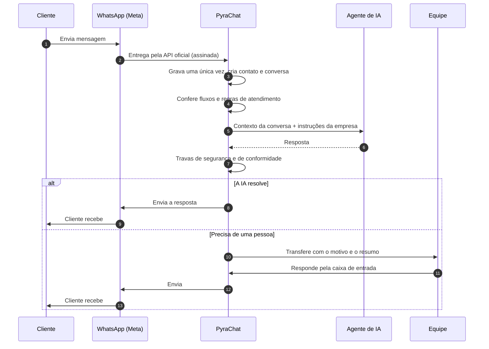

<picture>
  <source media="(prefers-color-scheme: dark)" srcset="https://pyrachat.com/marca/pyrachat-logo.svg" />
  
</picture>

### A IA atende. Sua equipe fecha.

Atendimento pelo WhatsApp com agentes de IA e equipe na mesma caixa de entrada.

**[pyrachat.com](https://pyrachat.com)** · [Entrar na plataforma](https://app.pyrachat.com) · [contato@pyrachat.com](mailto:contato@pyrachat.com)

> [!NOTE]
> **Este repositório é só documentação.** Ele explica o que é a PyraChat, como ela funciona e o que vem por aí. Não há código-fonte aqui: o código da PyraChat é proprietário e não é público.

## Sumário

- [O que é a PyraChat](#o-que-é-a-pyrachat)
- [Para quem é](#para-quem-é)
- [Como funciona: a orquestração](#como-funciona-a-orquestração)
- [O que a plataforma faz hoje](#o-que-a-plataforma-faz-hoje)
- [A IA da PyraChat](#a-ia-da-pyrachat)
- [Planos](#planos)
- [Segurança e privacidade](#segurança-e-privacidade)
- [Próximas atualizações](#próximas-atualizações)
- [Linha do tempo](#linha-do-tempo)
- [Contato](#contato)

## O que é a PyraChat

A PyraChat é uma plataforma de atendimento pelo **WhatsApp oficial**. Agentes de inteligência artificial respondem os clientes a qualquer hora, seguindo as instruções da sua empresa, e passam a conversa para uma pessoa da equipe quando é a hora certa, com o resumo pronto.

Tudo acontece num lugar só: a caixa de entrada da equipe, o cadastro dos contatos, o funil de vendas, os disparos, os fluxos automáticos, a agenda e os relatórios.

## Para quem é

**O céu é o limite.** A PyraChat atende qualquer negócio que conversa com clientes pelo WhatsApp, de qualquer porte e segmento: do profissional que trabalha sozinho à grande operação com várias equipes.

| Atendimento presencial | Vendas e serviços pela internet |
|---|---|
| Clínicas, consultórios e estética | Lojas online e e-commerce |
| Imobiliárias e corretores | Cursos, mentorias e infoprodutos |
| Restaurantes, bares e delivery | Agências e prestadores de serviço |
| Academias, salões e studios | SaaS e empresas B2B |
| Escritórios, oficinas e lojas físicas | Qualquer operação com muitas conversas |

Empresas contratam com CNPJ. Pessoas físicas também podem contratar, depois de uma verificação de identidade.

## Como funciona: a orquestração

Cada mensagem passa por uma sequência de etapas pensada para responder rápido, sem perder nada e sem expor o número da empresa a bloqueios.

1. **Entrada segura.** O WhatsApp entrega a mensagem pela API oficial da Meta. A PyraChat confere a assinatura de cada entrega e grava cada mensagem uma única vez, mesmo que a Meta reenvie.
2. **Fila e ordem.** As mensagens entram numa fila e são processadas em segundo plano, na ordem certa. Se algo cair no meio, nada se perde e nada é enviado em dobro.
3. **Fluxos e regras.** Antes da IA, valem as regras da empresa: horário de atendimento, boas-vindas, palavras-chave e fluxos automáticos (por exemplo, oferecer horários da agenda).
4. **Agente de IA.** A IA espera alguns segundos para juntar mensagens seguidas e responde com o contexto **só daquela conversa** e as instruções que a empresa definiu: tom, regras, limites e quando chamar uma pessoa.
5. **Travas antes de responder.** A resposta passa por conferências contra vazamento de instruções, links fora do combinado e repetição. Tudo é verificado de novo logo antes do envio; se o cliente mandou algo novo nesse meio tempo, a resposta antiga é descartada.
6. **Transferência para a equipe.** Quando o cliente pede uma pessoa, quando a IA não deve responder ou quando algum limite é atingido, a conversa vai para a equipe com o motivo e o resumo, distribuída por rodízio.
7. **Envio com conformidade.** Toda mensagem, da IA ou da equipe, passa pela trava de envio: janela de 24 horas, consentimento do cliente, qualidade do número e limites da Meta.
8. **Tempo real.** A equipe vê tudo acontecer ao vivo na caixa de entrada, no computador ou no celular.
9. **Depois da conversa.** O contato fica no cadastro com etiquetas e campos, a oportunidade anda no funil, o agendamento entra na agenda e tudo vira relatório.

## O que a plataforma faz hoje

| Módulo | O que você consegue fazer |
|---|---|
| **Caixa de entrada** | Conversas em tempo real, equipes com rodízio, assumir e transferir, notas internas, respostas rápidas, horário de atendimento e mensagens automáticas. |
| **Agentes de IA** | Criar agentes por etapas (papel, objetivo, regras, exemplos), testar antes de publicar, guardar versões e escolher entre responder sozinho ou só sugerir respostas. |
| **WhatsApp oficial** | Conectar o número pela Meta em poucos cliques, criar e enviar modelos de mensagem e respeitar automaticamente quem pediu para sair. |
| **Contatos** | Etiquetas, campos personalizados, segmentos e importação de planilhas. |
| **Funil** | Etapas de venda, oportunidades com valor e um quadro para arrastar. |
| **Disparos** | Campanhas para segmentos ou etiquetas, com agendamento, ritmo controlado e relatório de entregues e lidos. |
| **Fluxos** | Editor visual de automações: gatilhos (palavra-chave, contato novo, etiqueta, etapa do funil, conversa encerrada, lembrete e falta na agenda) e blocos (mensagem, botões, listas, mídia, esperar, condições, IA, divisão de público, oferecer horários). Prévia num WhatsApp simulado. |
| **Agenda** | Agendas com capacidade, visão de dia, semana e mês, horários oferecidos pelo próprio fluxo, lembrete e aviso de falta. |
| **Relatórios** | Atendimento, IA, equipe e agenda: primeira resposta, tempo de resolução, carga por pessoa, consumo de IA e comparecimento. |
| **Equipe e conta** | Papéis (dono, administrador, atendente, leitura), convites, verificação em duas etapas, logo da empresa no menu de toda a equipe e registro de auditoria. |

## A IA da PyraChat

A IA da PyraChat roda em **modelos próprios**, hospedados em servidores nos Estados Unidos, e tem três níveis, para equilibrar custo e capacidade em cada agente:

| Nível | Perfil |
|---|---|
| **Pyra Lite** | o mais econômico |
| **Pyra Max** | intermediário |
| **Pyra Ultra** | o mais avançado |

- **Cobrança por token, não por mensagem.** Você paga pelo que a IA lê e escreve. Uma mensagem consome, em média, de 300 a 800 tokens, então o custo por mensagem fica abaixo de 2 centavos em qualquer nível.
- **Feita para atendimento.** A IA já vem ligada à caixa de entrada, à transferência para a equipe, ao funil e à agenda, com travas pensadas para conversas com clientes.
- **Chave própria (no lançamento).** Quem preferir poderá usar a própria conta de um provedor de IA, como Claude (Anthropic), ChatGPT (OpenAI), Gemini (Google), DeepSeek, Z.ai e Qwen. A chave fica guardada cifrada, e o consumo é pago direto ao provedor. Os resultados podem ser diferentes dos níveis Pyra, que são preparados especificamente para atendimento.

## Planos

| Plano | Preço | Crédito de IA incluso |
|---|---|---|
| Sem crédito de IA | a partir de **R$ 49,90/mês** | não incluso |
| Com crédito de IA | a partir de **R$ 79,90/mês** | R$ 29,90 por mês |

- **Teste grátis (no lançamento):** 72 horas de uso, uma vez por empresa ou pessoa, com o celular confirmado e a forma de pagamento cadastrada. Cancelando antes do fim, nada é cobrado; sem cancelar, a assinatura do plano escolhido começa.
- **Pagamento (no lançamento):** Pix Automático ou cartão, dentro da própria plataforma, sem link externo. Os dados do cartão ficam com a instituição de pagamento, não com a PyraChat.
- **Planos especiais** para operações maiores, com o nosso comercial.
- **Valores de lançamento.** A tabela completa sai no lançamento, e as condições em vigor ficam sempre em [pyrachat.com](https://pyrachat.com).

## Segurança e privacidade

- **API oficial do WhatsApp**, da Meta. Nada de conexão não oficial pelo QR code, que coloca o número em risco.
- **Plataforma no Brasil.** A plataforma e as cópias de segurança ficam em servidores em São Paulo. Os modelos de IA próprios da PyraChat rodam em servidores nos Estados Unidos.
- **Cada empresa isolada.** O isolamento entre empresas é garantido no próprio banco de dados, não só no código, e é testado a cada alteração.
- **Proteção de acesso.** Verificação em duas etapas, sessões protegidas, registro de auditoria, pausa depois de tentativas erradas de entrada e verificação contra robôs no cadastro e na entrada.
- **Criptografia** dos acessos ao WhatsApp e cópias de segurança cifradas.
- **LGPD.** Termos de Uso, Política de Privacidade e Política de Cookies públicos, com encarregado de dados. As conversas só são usadas para melhorar a IA quando o cliente autoriza, ao criar o agente.
- **Falhas de segurança** podem ser comunicadas a [seguranca@pyrachat.com](mailto:seguranca@pyrachat.com).

## Próximas atualizações

O que está planejado ou em estudo. A lista evolui conforme o uso, sem datas fixas, e cada integração depende da aprovação de quem a oferece.

### Pagamentos

- **Pix na conversa:** cobrança gerada pela IA ou pela equipe e baixa automática quando o cliente paga.
- **Gateways de pagamento**, como Mercado Pago, Stripe, Asaas, PagBank, Efí, Pagar.me e Woovi.

### Marketplaces e e-commerce

- **Marketplaces:** perguntas, pedidos e pós-venda de canais como Mercado Livre, Shopee, Amazon e Magalu na mesma caixa de entrada.
- **Plataformas de loja virtual**, como Shopify, Nuvemshop, WooCommerce, VTEX e Tray: status do pedido, carrinho abandonado e recompra.

### Canais

- **Instagram Direct**, na mesma caixa de entrada.

### Inteligência artificial

- **Níveis Pyra Lite, Max e Ultra** com cobrança por token.
- **Chave própria** de provedores de IA.
- **Base de conhecimento:** documentos, catálogos e páginas que a IA consulta para responder.

### Gestão e integrações

- **Agenda integrada** ao Google Calendar.
- **API pública e servidor MCP** para conectar sistemas próprios e assistentes de IA.
- **Pixel da Meta** para medir campanhas.
- **Perfis de permissão** personalizados.
- **Verificação de identidade** para contratação por pessoa física.

> As marcas citadas pertencem aos seus titulares. A menção indica uma integração prevista ou em estudo, não uma parceria ou endosso.

## Linha do tempo

| Versão | O que chegou |
|---|---|
| v0.23 – v0.26 | Pagamento da assinatura dentro da plataforma (Pix Automático e cartão) e teste grátis protegido, prontos para o lançamento |
| v0.22 | Logo da empresa no menu, entrada mais espaçosa e a mesma marca no app e no site |
| v0.21 | Acesso antecipado e novas telas de entrada |
| v0.20 | Entrada mais protegida, Condições Comerciais e [blog de novidades](https://pyrachat.com/blog) |
| v0.19 | Site público, Termos e políticas, domínio pyrachat.com |
| v0.18 | Nova interface: mais espaço, controles próprios e modais |
| v0.16 – v0.17 | Agenda, horários oferecidos pelo fluxo, lembretes e falta |
| v0.11 – v0.15 | Fluxos: editor visual, ramificações, IA, mídia e prévia |
| v0.10 | Disparos com trava de conformidade |
| v0.9 | Funil de vendas |
| v0.8 | Contatos: etiquetas, campos, segmentos e importação |
| v0.7 | Relatórios e agentes de IA por etapas |
| v0.6 | Nova cara da plataforma e painel inicial |

## Contato

| Assunto | Endereço |
|---|---|
| Geral e comercial | [contato@pyrachat.com](mailto:contato@pyrachat.com) |
| Suporte | [suporte@pyrachat.com](mailto:suporte@pyrachat.com) |
| Privacidade | [privacidade@pyrachat.com](mailto:privacidade@pyrachat.com) |
| Segurança | [seguranca@pyrachat.com](mailto:seguranca@pyrachat.com) |

---

© 2026 PyraChat · Grupo PlayHub (PlayHub Holding LTDA), CNPJ 65.540.378/0001-23. Todos os direitos reservados. Este documento descreve o produto e não é proposta comercial: valem as condições publicadas em pyrachat.com.
